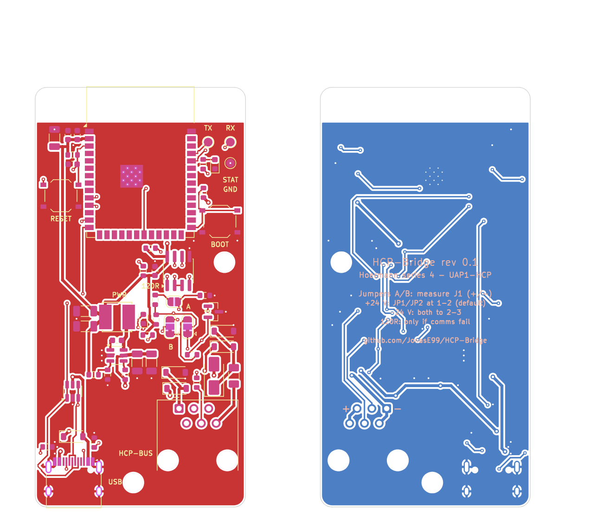

# HCP-Bridge – Hörmann series 4 garage doors on Wi-Fi / Loxone

> **⚠ Work in progress – rev 0.1 has not been manufactured or tested yet.**
> Schematic and layout are complete and checked (ERC 0 errors, DRC 0 errors), but no board has
> been built or run on an operator so far. Build at your own risk; results of the first build
> will be added here.

A small board (one per door) that plugs into the **BUS port** (RJ12) of a Hörmann series 4
garage door operator (ProMatic 4, SupraMatic E/P 4). It acts as a UAP1-HCP expansion module
towards the operator and exposes the door via Wi-Fi. Loxone talks to it over plain HTTP, no
extra server needed (see below).

**Firmware:** This repository contains the hardware only. The board is meant to run the existing
third-party open-source firmware **[HCPBridgeMqtt by Gifford47](https://github.com/Gifford47/HCPBridgeMqtt)**
(environment `HCP_Giffordv2`, provides web UI, HTTP API and MQTT). The board uses the same pins
as the original ESP32-S3 boards, so the firmware runs unchanged. Please direct firmware questions
to that project.

**Status rev 0.1 (2026-10-14):** ERC 0 errors, DRC 0 errors (4 warnings: footprint silkscreen at
the board edge, trimmed by the manufacturer).



## Key data

| | |
|---|---|
| Size | 36 × 72 mm, 2 layers, 1.6 mm, 2 × M3 |
| Power | from the bus (24 V, approx. 20–40 mA) or USB-C (5 V) |
| Radio | ESP32-S3-WROOM-1-N8R2 (PCB antenna at the top edge, no copper underneath) |
| RS-485 | TI THVD1406, automatic direction control via TX (the firmware uses TX/RX only) |
| Protection | 200 mA PTC fuse, TVS SMAJ33CA, SM712 + 10 Ω on A/B, ESD protection on USB |
| Regulator | TI LMR51610 (4–65 V, 1 A) to 3.3 V, laid out following the TI layout guidelines |
| Pins | RS-485 TX = GPIO17, RX = GPIO18, status LED = GPIO13 (as `HCP_Giffordv2`) |

### Reverse polarity and cable tolerant

RJ12 cables exist as straight and crossed versions, and the pin 1 side of the jack was derived
from documentation. Reversed, +24 V would end up on GND and A/B would be swapped. Therefore:
- Power goes through a **bridge rectifier** (4 × Schottky): polarity does not matter and the
  board is not damaged either way.
- **Solder jumpers A/B** (JP1/JP2), default 1-2 (A = jack pin 4, B = pin 3).
- **JP3 "120R"** (bus termination): leave open, close only if communication is unreliable.

**Setting A/B – one measurement is enough:** cable and jack can only swap the wires mirrored
(1↔6, 2↔5, 3↔4), so power and data always flip together. With the bridge plugged in and the
operator powered, measure on the **bottom side at the solder pins of the RJ12 jack J1**: red probe
on the pin marked **"+"** (pin 5, outer pin), black probe on the pin marked **"−"** (pin 1, outer
pin on the other end):

| Reading at J1 (+ against −) | JP1 and JP2 |
|---|---|
| approx. **+24 V** | keep at **1-2** (default) |
| approx. **−24 V** | resolder **both to 2-3** |

The rule is also printed on the bottom side. Bus pinout at the operator according to
HCPBridgeMqtt: 1/2 GND, 3 B−, 4 A+, 5/6 +24 V.

## Folders

```
hardware/kicad/        KiCad 9 project HCPBridge.kicad_pro (schematic, PCB, own footprints)
hardware/fabrication/  schematic PDF, Gerber ZIP, BOM, LCSC order file, JLCPCB BOM + CPL, assembly drawing, ERC/DRC
docs/                  board render
```

## Ordering (2 doors → 2 boards, plan a spare)

- **PCB:** upload `hardware/fabrication/HCPBridge-gerber.zip` to JLCPCB (2 layers, 1.6 mm,
  lead-free HASL; 5 pcs is the minimum).
- **Parts:** at [lcsc.com](https://www.lcsc.com) open **BOM Tool → Upload BOM File** and upload
  `hardware/fabrication/lcsc-order.xlsx` (or `lcsc-order.csv`). When asked to assign the columns,
  choose `LCSC Part Number` → LCSC Part Number and `Quantity` → Quantity. **`Quantity` is the
  quantity per board**; enter the number of boards (e.g. 3 = 2 doors + 1 spare) as the order
  multiplier in the BOM tool. The column `Total for 3 boards + spare` is for checking only (it
  adds 5 spare pieces of each small 0603 part, which tend to get lost when hand soldering), do
  not assign it. LCSC rounds up to its minimum order quantities. `bom.csv` is the per-board list
  with reference designators. Solder jumpers and test points are copper only.
- **JLCPCB assembly (alternative to hand soldering):** upload `jlcpcb-bom.csv` (BOM) and
  `jlcpcb-cpl.csv` (pick and place) in the PCB assembly step. Rotations and reference points were
  derived from the LCSC/EasyEDA footprints. Check D8, F1, L1 and U1 in the JLC placement preview:
  their EasyEDA data could not be compared (pin 1 of D8/U1 must match the marking on the board).
  J1 (RJ12) is a through-hole part; select it only if you also order through-hole assembly.
- **Optional:** order a stencil from JLCPCB as well, it makes USB-C and the ESP32 module much
  easier.
- **Cable:** RJ12 6P6C cable with **all 6 wires populated** (many phone cables only have 4!).
  Straight or crossed does not matter, the solder jumpers take care of it.

## Assembly and first start

1. Populate the regulator first (U1, L1, C1–C5, R1–R4, D7) and power it from USB-C: green LED on,
   3.3 V across C4. Then the rest. Assembly drawing: `hardware/fabrication/assembly.pdf`.
2. Flash the firmware with PlatformIO (guide:
   [flashing_instructions.md](https://github.com/Gifford47/HCPBridgeMqtt/blob/master/docs/flashing_instructions.md)),
   environment **`HCP_Giffordv2`** (ESP32-S3, TX 17 / RX 18, LED 13, PSRAM). Connect USB-C to the
   PC; if the ESP32 is not detected: hold BOOT, press RESET.
3. The bridge opens a hotspot; enter your Wi-Fi at `http://192.168.4.1`, then assign a **fixed
   IP** in your router. Set a password in the web UI (see Loxone).
4. **Unplug USB**, plug the bridge into the BUS port of the operator with the RJ12 cable.
5. **Measure at J1** (bottom side, "+"/"−") and set the A/B jumpers accordingly (see above).
   Unplug the RJ12 cable before resoldering.
6. Start a **bus scan** on the operator (otherwise it does not see the bridge): depending on the
   control board via menu 37 or by switching the last DIP switch ON → OFF. Guide:
   [bus_scan_EN.md](https://github.com/Gifford47/HCPBridgeMqtt/blob/master/docs/bus_scan_EN.md).
   The door state must then show up in the web UI.

Do not connect USB (PC) and the bus at the same time if PC and operator are earthed differently.

## Loxone integration (HTTP, no MQTT)

The commands are simple GET requests. With a web password set, the bridge asks for basic auth
(user `admin`); in Loxone use the address `http://admin:<password>@<ip>`.

**Virtual output** "Garage door 1", address `http://admin:<pw>@192.168.x.y`, commands:

| Command | Request on ON |
|---|---|
| Open | `/command?action=1` |
| Close | `/command?action=0` |
| Stop | `/command?action=2` |
| Toggle (impulse) | `/command?action=8` |
| Half open | `/command?action=4` |
| Venting | `/command?action=3` |
| Toggle light | `/command?action=5` |
| Position (0–100) | `/command?action=7&position=<v>` (analog) |

**Virtual HTTP input** "Garage door 1 status", URL `http://admin:<pw>@192.168.x.y/status`, polling
every 2–5 s. Command recognition:

| Value | Command recognition | Meaning |
|---|---|---|
| Position | `"currentPosition":\v` | 0 = closed … 100 = open |
| State | `"state":\v` | 0 open, 1 opening, 2 closed, 3 closing, 4 half open, 5/6 venting, 7 moving to half, 8 stopped |
| Light | `"light":\v` | 1 = on (true) |
| Bus OK | `"valid":\v` | 1 = operator responds |

**Gate block:** set the Loxone "Gate" block to "subsequent control" and connect its outputs Op/Cl
(or Tg) to the Open/Close (or Toggle) commands of the virtual output. Feedback comes from the HTTP
input: end position open = state 0, end position closed = state 2, the position directly from
`currentPosition` / 100. The exact inputs and outputs of the block are described in the Loxone
documentation: <https://www.loxone.com/enen/kb/gate/>. Please double-check in Loxone Config; this
mapping has not been tested on a real Miniserver yet.

## Credits and sources

- Firmware and protocol: [Gifford47/HCPBridgeMqtt](https://github.com/Gifford47/HCPBridgeMqtt),
  [Tysonpower/HCPBridgeMqtt_tynet](https://github.com/Tysonpower/HCPBridgeMqtt_tynet)
- Datasheets: [THVD1406](https://www.ti.com/lit/ds/symlink/thvd1406.pdf),
  [LMR51610](https://www.ti.com/lit/ds/symlink/lmr51610.pdf)
- RJ12 hole pattern (Molex 95501-2661): taken from the Gerber files of the board by vladimirzrnic
  in the HCPBridgeMqtt repository (`docs/PCB/vladimirzrnic`)
